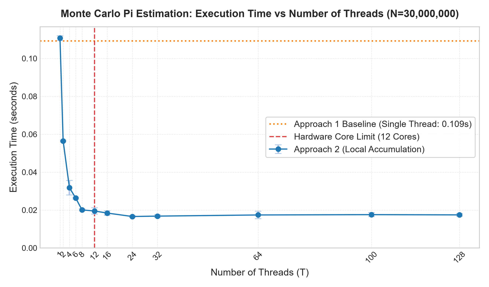
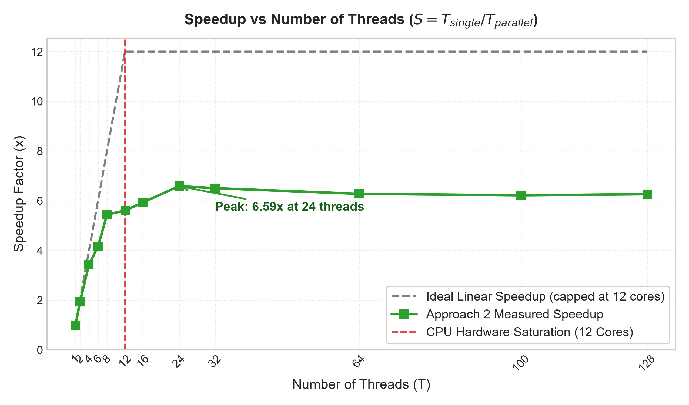

## 5. Performance Analysis

The experiment used **30 million points**, with **five runs per configuration**. Results are reported as average execution times. The virtual machine had **2 logical CPUs**. The three approaches were a single-thread baseline, multi-threaded local accumulation, and a shared counter protected by a mutex.

### 5.1. Performance Curves

_Figure 1. Average execution time versus number of threads. Lower execution time indicates better performance._

_Figure 2. Speedup versus number of threads. Speedup equals the single-thread baseline time divided by the measured execution time. A value below 1 indicates slower execution than the baseline._

The vertical reference line marks the VM's two allocated logical CPUs, not an experimentally established saturation point.

### 5.2. Required Explanations

**A. Non-linear Speedup**

Increasing the number of threads does not produce a proportional speedup. Approach 2 achieved approximately **1.68× with 2 threads** and **2.08× with 8 threads**, rather than 8×. Limited CPU resources and thread-management overhead restrict the improvement. Diminishing returns are visible: increasing from 4 to 8 threads reduced execution time only from approximately **0.0512 to 0.0461 seconds**.

**B. Saturation Point**

Among the tested configurations, Approach 2 achieved its lowest average execution time at **8 threads: approximately 0.0461 seconds**. Increasing to 12–128 threads provided no further improvement. This does not mean the machine had 8 cores: the VM had only **2 logical CPUs**. Eight threads was the best observed configuration in this dataset, with scheduling and VM variability potentially influencing the result.

**C. Oversubscription**

When the number of threads exceeds the available CPUs, threads must share CPU execution time. For Approach 2, execution time increased from **0.0461 seconds at 8 threads** to **0.0679 seconds at 128 threads**, reducing speedup from **2.08× to 1.41×**. Scheduling and context-switching overhead may contribute to this slowdown, although context switches were not measured directly.

**D. Synchronization Cost**

Approach 3 acquires a mutex whenever it increments the shared counter, causing threads to compete for the lock and wait. With **8 threads**, it took approximately **0.8150 seconds**, about **17.7 times longer** than Approach 2. Local accumulation avoids this repeated synchronization by maintaining separate counters and combining results after the workers finish.

**E. Parallel Efficiency**

Parallel efficiency is calculated as **Efficiency = Speedup / Number of Threads × 100%**. For Approach 2, efficiency decreased from **83.9% at 2 threads** to **26.0% at 8 threads** and approximately **1.1% at 128 threads**. Additional threads therefore delivered progressively less speedup per thread. This metric describes parallel scaling efficiency, not CPU utilization.

_Measurement note: the current multi-threaded implementations include thread creation and joining within the timed interval. The reported results therefore include these costs._
