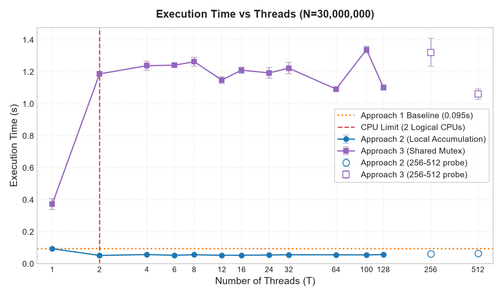
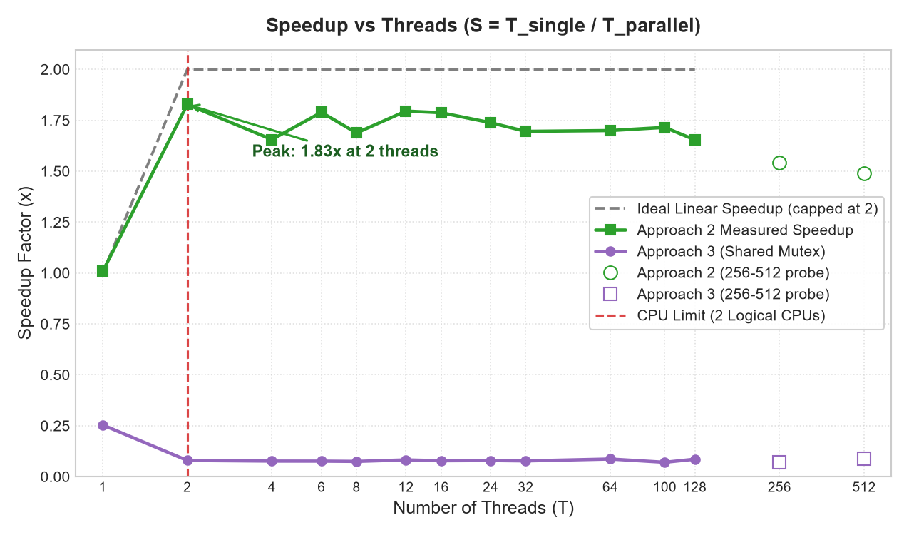
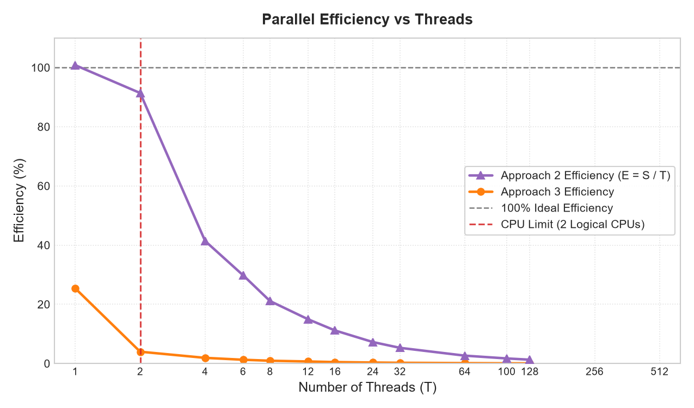
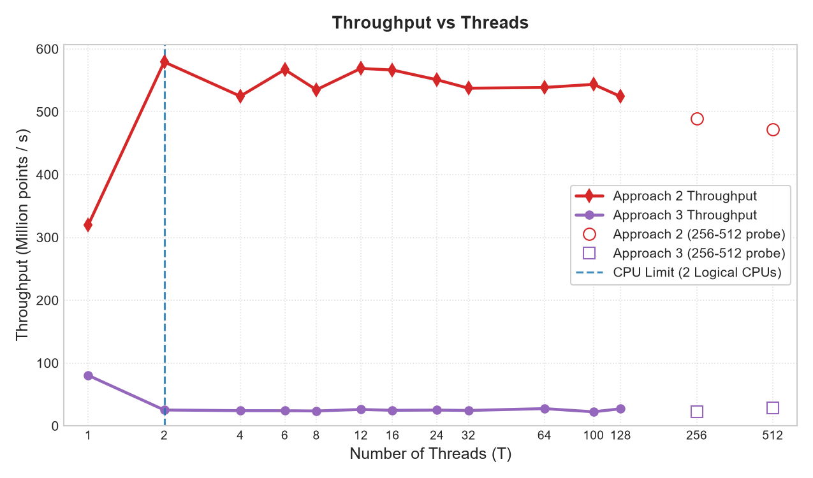
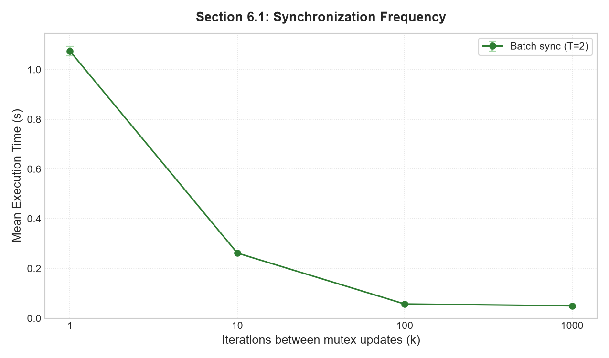
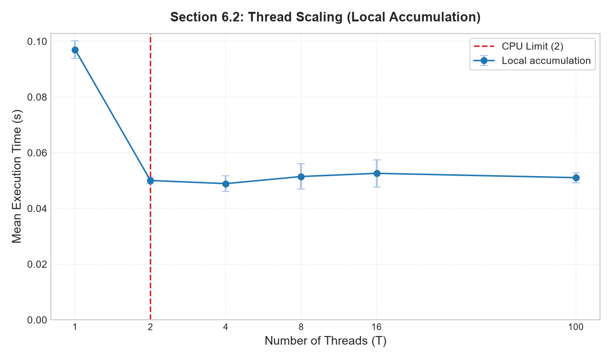
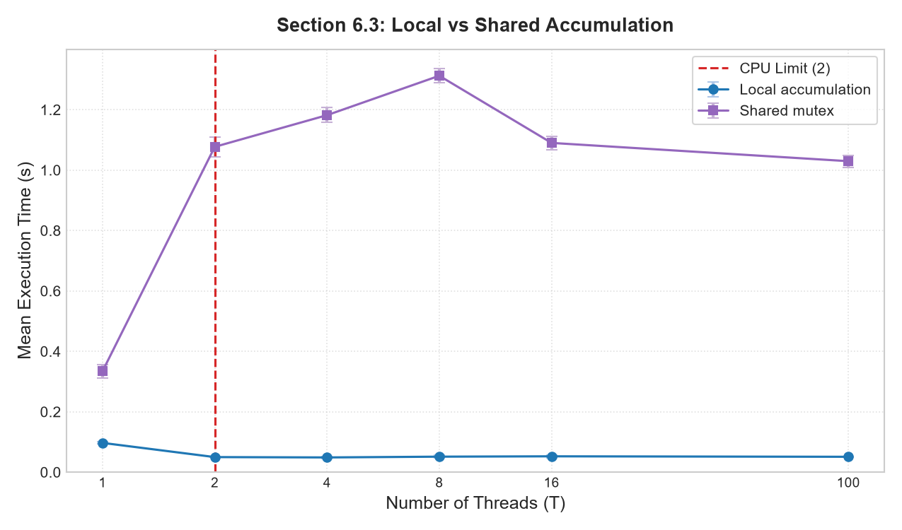

# Analysis and Explanations

**Exercise:** Week 3 — Multi-threading Best Practices via Monte Carlo π Estimation
**Scope:** Explains the measured behaviour required by Sections 5 and 6 of the specification.

All numbers below come from **one source revision and one measurement campaign**
(2026-11-03). The earlier VMware and Windows datasets that appeared in previous
drafts have been removed; they used a different timing boundary and are not
comparable with this report.

---

## 1. Executive summary

1. The single-thread baseline estimates π as **3.141434** in **0.094655 s** for
   30 million points (316.9 Mpoints/s, 2.9% run-to-run variation).
2. Local accumulation (Approach 2) is the only design that scales: it reaches
   **1.83×** at 2 threads and **579.3 Mpoints/s**, then plateaus at
   1.65–1.80× for 4–128 threads, exactly as a 2-logical-CPU allocation
   predicts.
3. Per-hit locking (Approach 3) is **3.97× slower than the baseline with one
   thread** (0.3727 s vs 0.0947 s) and only **0.07–0.09×** with two or more
   threads. At 2 threads it is **22.9× slower** than local accumulation, because
   ~23.6 million lock/unlock pairs serialize the hot loop.
4. Batching the shared update every **k = 1,000** iterations reduces time from
   **1.0744 s to 0.0499 s (21.5×)** at 2 threads, reaching the local-accumulation
   floor (0.0500 s) while producing the identical π value.
5. Oversubscription is visible but mild until the thread count becomes very
   large: 128 threads are only ~10% slower than the 2-thread peak (1.65× vs
   1.83×), because thread creation/join are outside the measured region and each
   worker still receives a substantial block of work. A supplementary probe at
   256 and 512 threads falls to **1.54× and 1.49×** (19% below the peak), which
   completes the expected **increasing → plateau → decreasing** pattern.

---

## 2. Experimental setup

### 2.1 Environment

| Item | Value |
|:--|:--|
| OS / kernel | Ubuntu 24.04 on WSL2, `Linux 6.6.87.2-microsoft-standard-WSL2` |
| Visible logical CPUs | 12 (WSL sees the full host) |
| CPUs used by the benchmark | **2**, pinned with `taskset -c 0-1` |
| Host CPU (reference) | Intel Core i7-14650HX |
| Compiler / flags | GCC 13.3.0, `-O3 -pthread -Wall -Wextra -lm` |
| Problem size | N = 30,000,000 points (strong scaling) |
| Repetitions | 5 per configuration; mean and population standard deviation reported |
| Master seed | `123456789`; run *r* uses `master + 99991r` |
| Randomness | `xorshift64*`, one independent state per thread, seeded from the master seed and thread id |

Pinning makes the comparison meaningful on a 12-CPU host, but WSL2 still shares
the physical machine with Windows and with other processes. The 2–9% spread of
repeated runs is the resulting noise floor. The SMT relationship between logical
CPUs 0 and 1 was not verified; they may be two threads of one physical core or
two separate cores.

### 2.2 Timing methodology

- All timings use `clock_gettime(CLOCK_MONOTONIC)`.
- **Approach 1** times only the sampling loop.
- **Approaches 2, 3 and the batch variant** create every worker first. A
  `StartGate` (mutex + condition variable) holds the workers until setup is
  complete; releasing the gate records `t_start` and wakes all workers at once.
  Each worker records `finished_at` immediately after its loop, and the elapsed
  time is `max(finished_at) − t_start`.

Consequences:

- Thread creation, `pthread_join`, allocation, seed setup, mutex
  initialisation/destruction, the final reduction and all printing are **outside**
  the measured region. This follows the specification's instruction not to
  include initialisation or I/O in timing.
- The measured region still includes everything that happens *after* the
  simultaneous start: scheduling, cache-line contention, lock queueing and
  oversubscription effects. It is therefore a fair measure of parallel
  computation, not of thread setup.
- Earlier drafts measured `pthread_create → pthread_join`, which inflates the
  cost of high thread counts. Those numbers are superseded.

Derived metrics:

- Speedup `S = T_single / T_parallel`, using the Approach 1 mean as `T_single`.
- Efficiency `E = S / T`.
- Throughput `N / T_parallel`.

### 2.3 Designs under test

| Approach | Work distribution | Shared state in the hot loop | Synchronization |
|:--|:--|:--|:--|
| 1 — Single thread | All N points | None | None |
| 2 — Local accumulation | N/T per thread (remainder to the last thread) | None | One start gate + final reduction |
| 3 — Shared mutex | N/T per thread | Global counter | `pthread_mutex_lock` on **every point inside the circle** |
| 3b — Batch sync | N/T per thread | Global counter | Lock every *k* iterations, flush the remainder at the end |

The expected fraction of points inside the circle is π/4 ≈ 0.7854, so Approach 3
performs about **23.56 million** lock/unlock pairs for N = 30M.

### 2.4 Correctness and noise

All configurations estimate π between **3.141393** and **3.141816**, with
absolute error at most **0.000224**. The expected 1σ sampling error for N = 30M is
about 0.00030, so every result is within one standard deviation of the true value.

Approaches 2 and 3 produce **identical** π values for the same thread count
(e.g., both give 3.1413932 at T = 8), and the batch variant at T = 2 reproduces
the Approach 2/3 value for every *k* (3.1415246). This proves that the mutex
loses no updates and that batching flushes every partial batch correctly.

The baseline coefficient of variation is 2.9%; individual parallel
configurations range from 1.1% to 9.1%. Differences smaller than roughly two
combined standard deviations are not treated as real effects in this report.

---

## 3. Measured results

Full tables are in [`summary_tables.md`](../2_measurements/summary_tables.md);
raw runs are in [`measurements.csv`](../2_measurements/measurements.csv) and
[`section6_results.csv`](../2_measurements/section6_results.csv).

### 3.1 Baseline (Approach 1)

| Mean time | Std. dev. | Throughput | Estimated π | Absolute error |
|--:|--:|--:|--:|--:|
| 0.094655 s | ± 0.002753 s | 316.9 Mpoints/s | 3.141434 | 0.000158 |

### 3.2 Approach 2 — local accumulation

| Threads | Mean time (s) | Std dev (s) | Speedup | Efficiency | Throughput (Mpts/s) |
|:--:|--:|--:|--:|--:|--:|
| 1 | 0.0939 | 0.0026 | 1.01× | 100.8% | 319.5 |
| 2 | **0.0518** | 0.0014 | **1.83×** | 91.4% | **579.3** |
| 4 | 0.0572 | 0.0027 | 1.66× | 41.4% | 524.8 |
| 6 | 0.0529 | 0.0010 | 1.79× | 29.8% | 567.1 |
| 8 | 0.0561 | 0.0048 | 1.69× | 21.1% | 535.0 |
| 12 | 0.0527 | 0.0009 | 1.80× | 15.0% | 569.0 |
| 16 | 0.0530 | 0.0022 | 1.79× | 11.2% | 566.5 |
| 24 | 0.0544 | 0.0017 | 1.74× | 7.2% | 551.0 |
| 32 | 0.0558 | 0.0031 | 1.70× | 5.3% | 537.5 |
| 64 | 0.0557 | 0.0039 | 1.70× | 2.7% | 538.7 |
| 100 | 0.0552 | 0.0035 | 1.72× | 1.7% | 543.6 |
| 128 | 0.0572 | 0.0026 | 1.65× | 1.3% | 524.3 |

The 1-thread result (1.01×) confirms that the start gate and the extra worker
bookkeeping cost less than 1% of the loop time.

A supplementary probe at 256 and 512 threads (same environment and methodology,
5 runs each) resolves the declining phase of the curve:

| Threads | Mean time (s) | Std dev (s) | Speedup | Throughput (Mpts/s) | Estimated π |
|:--:|--:|--:|--:|--:|--:|
| 256 | 0.0613 | 0.0036 | 1.54× | 489.2 | 3.141695 |
| 512 | 0.0636 | 0.0031 | 1.49× | 471.7 | 3.141471 |

These points are shown as hollow markers in the figures and are stored in
`high_thread_probe.csv` / `high_thread_probe_summary.csv`.

### 3.3 Approach 3 — per-hit mutex

| Threads | Mean time (s) | Std dev (s) | Speedup | Efficiency | Throughput (Mpts/s) |
|:--:|--:|--:|--:|--:|--:|
| 1 | 0.3727 | 0.0339 | 0.25× | 25.4% | 80.5 |
| 2 | 1.1868 | 0.0132 | 0.08× | 4.0% | 25.3 |
| 4 | 1.2381 | 0.0286 | 0.08× | 1.9% | 24.2 |
| 8 | 1.2630 | 0.0282 | 0.07× | 0.9% | 23.8 |
| 16 | 1.2102 | 0.0194 | 0.08× | 0.5% | 24.8 |
| 32 | 1.2226 | 0.0351 | 0.08× | 0.2% | 24.5 |
| 100 | 1.3385 | 0.0213 | 0.07× | 0.1% | 22.4 |
| 128 | 1.1021 | 0.0169 | 0.09× | 0.1% | 27.2 |

(The full 12-point table, including 6, 12, 24, 64, is in `summary_tables.md`.)
For every T ≥ 2 the aggregate time stays between 1.03 s and 1.34 s, i.e. it is
essentially independent of the thread count.

### 3.4 Performance curves

Hollow markers in the time, speedup and throughput figures are the supplementary
256/512-thread probe; efficiency omits them because both values are below 1%.

---

## 4. Required explanations (Section 5.2)

### A. Why speedup is not proportional to the number of threads

Ideal strong scaling would give `S(T) = T` while `T` does not exceed the number
of usable cores. Measured Approach 2 instead gives 1.83× at 2 threads and stays
between 1.65× and 1.80× from 4 to 128 threads. The gap has four sources:

1. **A hard core limit.** The benchmark is pinned to 2 logical CPUs. Once both
   are busy, additional runnable threads cannot execute simultaneously; they
   merely take turns. This is the dominant effect and the reason the curve is
   flat beyond T = 2.
2. **Shared micro-architectural resources.** The two logical CPUs may be SMT
   siblings; they share execution units, the last-level cache and memory
   bandwidth. Even if they are separate cores, the host is running Windows and
   other processes, and per-core turbo frequency falls as more cores become
   active. Arithmetic throughput per thread therefore drops as threads compete.
3. **Fixed coordination overhead inside the measured region.** The start gate
   release wakes every worker; at high T the wake-up order and scheduler
   placement add a small, roughly constant cost that is included in
   `max(finished_at) − t_start`.
4. **Statistical noise.** The baseline varies by 2.9% and some parallel
   configurations by up to 9%. Differences smaller than about two combined
   standard deviations are not significant. For example, 1.83× at T = 2 and
   1.66× at T = 4 differ by 1.7× the combined standard deviation and should be
   read as the same plateau value.

**Diminishing returns** are visible directly: 1 → 2 threads gains 0.82× of
speedup; every later doubling adds essentially nothing (2 → 4, 4 → 8, 8 → 16
all remain within the noise band around 1.7–1.8×), and the 256/512-thread probe
reverses the trend (1.54× and 1.49×). A rough Amdahl fit from the 2-thread
point, `S = 1 / (f + (1−f)/2) = 1.83`, gives a non-parallel fraction of about
9%; this captures the gate, scheduling and resource-sharing overhead but cannot
explain the behaviour beyond 2 threads, where the core limit dominates.

### B. Saturation point

The speedup plateau begins at **2 threads**, the number of CPUs the process may
use, and extends through 128 threads. The nominal maximum is **1.83× at 2
threads**; the plateau average is about 1.72×. Using 2 threads is therefore the
correct operating point for this machine.

**Relation to hardware.** Saturation at ~1.8× is what a 2-logical-CPU allocation
predicts. The Section 6.2 rerun shows 1.89× at 2 threads and 1.94× at 4 threads;
the 4-thread value is within one standard deviation of the 2-thread value
(0.0489 ± 0.0029 s vs 0.0500 ± 0.0012 s), so it is not evidence of scaling past
two CPUs. It is a second measurement of the same plateau.

The decline at 128 threads (1.65×) is about 10% below the peak and roughly 1.8
combined standard deviations away, so on its own it is a weak effect. The
256/512-thread probe resolves it: 1.54× and 1.49× are 19% below the peak and far
outside the run-to-run spread. The decline is therefore real once
oversubscription becomes heavy; it is not a collapse, because the measured
region excludes thread setup.

### C. Oversubscription

Threads above the 2-CPU allocation oversubscribe the machine. Measured
behaviour in Approach 2:

- 4–16 threads: 0.0527–0.0572 s, speedup 1.66–1.80×;
- 24–64 threads: 0.0544–0.0558 s, speedup 1.70–1.74×;
- 100–128 threads: 0.0552–0.0572 s, speedup 1.65–1.72×;
- 256–512 threads (probe): 0.0613–0.0636 s, speedup 1.49–1.54×.

The penalty relative to the 2-thread peak is about **10% up to 128 threads** and
**19% at 512 threads**, not the 30–50% that wall-clock timings around
`pthread_create`/`pthread_join` typically show. Two properties of this experiment
explain the difference:

1. **Setup is excluded.** Creating and joining hundreds of threads costs
   hundreds of microseconds of wall time but is outside the measured region, by
   design.
2. **Each oversubscribed thread still gets real work.** At T = 128 each worker
   processes ~234,000 points, about 0.74 ms at the baseline throughput; at
   T = 512 it still processes ~58,600 points, about 0.18 ms. The OS time-slices
   the runnable threads across two CPUs; each context switch saves and restores
   registers and pollutes cache/TLB state. At 128 threads the switch cost is
   small relative to a 0.74 ms slice; at 512 it is no longer negligible, which is
   why the decline becomes unambiguous there.

The result is the expected **increasing → plateau → decreasing** pattern,
compressed by the measurement boundary. The non-monotonic points (e.g. 1.72× at
100 threads vs 1.65× at 128) are within noise, while the 512-thread decline is
well outside it.

### D. Synchronization cost: why Approach 3 is worse than Approach 2

Approach 3 locks a global mutex on every point inside the circle, about
**23.56 million** lock/unlock pairs. Approach 2 never touches shared memory in
the hot loop; it writes one stack-local counter and performs a single reduction
after all joins.

Measured consequences:

- **Single thread:** 0.3727 s vs 0.094655 s baseline → **3.97× slower** with zero
  contention. The extra ~0.278 s is lock/unlock overhead plus the extra branch,
  roughly **11.8 ns per hit**. That is an upper bound on the uncontended lock
  cost, because the baseline also includes the circle test and counter
  increment.
- **Two threads:** 1.1868 s vs 0.0518 s for Approach 2 → **22.9× slower**.
  Throughput falls from 579.3 to 25.3 Mpoints/s. With two CPUs, the two threads
  now contend for the same cache line, so the cost is much larger than the
  single-thread lock cost.
- **Four to 128 threads:** aggregate time stays between 1.03 s and 1.34 s. It
  does not fall with more threads and does not grow much either: the serialized
  critical-section work dominates, so adding threads adds queueing rather than
  throughput.

**Mechanism.** `pthread_mutex_lock` is an atomic read-modify-write on a shared
cache line. When several cores contend for it, the line migrates between their
private caches ("cache-line ping-pong"), and only one thread can execute the
increment at a time. The useful work inside the critical section is a single
integer increment, a few nanoseconds, while a contended acquisition costs tens
of nanoseconds. The critical section is therefore almost pure overhead, and it
**serializes 78.5% of the iterations**.

The batch experiment provides an independent check: at T = 2 with *k* = 1, the
batch variant takes 1.0744 s, within about 10% of Approach 3's 1.1868 s, as
expected for per-iteration flushing. Varying *k* isolates the synchronization
frequency from every other difference.

**Approach 3 vs Approach 2 in OS terms.** The shared counter creates a critical
section that must execute sequentially. Local accumulation removes the critical
section entirely and defers combination to an O(T) reduce phase. This is the
map-reduce pattern: eliminate contention rather than trying to make it cheap.

### E. Why parallel efficiency decreases with thread count

Efficiency is `E = S/T`. Measured values:

- Approach 2: 100.8% at 1 thread, 91.4% at 2, 41.4% at 4, 21.1% at 8, 7.2% at
  24, 1.7% at 100, 1.3% at 128.
- Approach 3: 25.4% at 1 thread, 4.0% at 2, 0.9% at 8, 0.1% at 64 and above.

Two distinct mechanisms are at work:

1. **At and below the core count**, overhead prevents perfect use of each
   thread: shared execution units, cache/memory bandwidth, gate wake-up and
   noise. The 100.8% value at T = 1 is measurement noise (the Approach 2 mean was
   0.8% faster than the baseline mean, well inside the 2.8–2.9% spread) and
   should be read as 100%.
2. **Above the core count**, speedup saturates while the denominator keeps
   growing, so efficiency falls roughly as `1/T` by construction. This is a
   property of the metric under oversubscription, not evidence that the code
   became worse. That is why efficiency should be interpreted mainly for
   `T ≤ cores`.

Approach 3 is already at 25.4% with one thread because the lock overhead consumes
about three quarters of the baseline time; efficiency then collapses as
contention is added. Reporting both speedup and efficiency, with the allocated
core count and error bars, prevents either metric from being read in isolation.

---

## 5. Trade-off experiments (specification Section 6)

All Section 6 runs use the same 2-CPU allocation, N = 30,000,000, 5 runs per
point, and the same build as the primary benchmark. Batch synchronization uses
T = 2.

### 5.1 Synchronization frequency (specification 6.1)

Approach 3 was modified to update the shared counter every *k* iterations
instead of on every hit (`src/approach3_batch.c`). Each thread accumulates
locally and flushes when `(i + 1) % k == 0`, plus a final flush.

| k | Mean time (s) | Std dev (s) | Speedup vs single | Change vs k = 1 |
|--:|--:|--:|--:|--:|
| 1 | 1.0744 | 0.0193 | 0.09× | 1.0× |
| 10 | 0.2620 | 0.0039 | 0.36× | 4.1× faster |
| 100 | 0.0571 | 0.0060 | 1.66× | 18.8× faster |
| **1,000** | **0.0499** | **0.0005** | **1.90×** | **21.5× faster** |

- Moving from per-hit locking to *k* = 1,000 cuts time by **21.5×** and raises
  speedup from 0.09× to 1.90×.
- The number of shared updates falls from ~23.6 million to about 30,000
  (30M / 1,000), a reduction of nearly three orders of magnitude.
- The curve flattens between *k* = 100 and *k* = 1,000, and the *k* = 1,000 result
  (0.0499 s) is statistically indistinguishable from purely local accumulation
  at T = 2 (0.0500 s). At this point the remaining synchronization no longer
  determines the runtime.
- Correctness is unchanged: every *k* produces **π = 3.141524640**, exactly the
  same value as Approaches 2 and 3 at T = 2. Batching changes when the counter is
  updated, not how many points are counted.

**Implementation note.** The flush test uses `(i + 1) % k` with a runtime
divisor, so the compiler emits an integer division in the loop. On this CPU the
out-of-order pipeline hides it behind the serial PRNG chain, and no penalty is
measurable at *k* ≥ 100. That is not guaranteed on other CPUs or compilers; a
countdown (`if (++since_update == k)`) or block-wise processing is more robust
and removes the division entirely.

### 5.2 Thread scaling below / at / above the core count (specification 6.2)

With 2 usable logical CPUs:

| Region | Threads tested | Observed (local accumulation) |
|:--|:--|:--|
| Below cores | 1 | 0.0970 s, 0.98× |
| At cores | 2 | 0.0500 s, 1.89× |
| Above cores | 4, 8, 16, 100 | 0.0489–0.0526 s, 1.80–1.94× |
| Far above cores | 256, 512 (probe) | 0.0613–0.0636 s, 1.49–1.54× |

The required **increasing → plateau → decreasing** pattern is present in full
across the primary sweep and the probe: 1.01× at T = 1, 1.83× at T = 2, a
1.65–1.80× plateau through 128 threads, and 1.49× at 512 threads. The Section 6.2
subset resolves the same plateau; its T = 4 point (1.94×) is within one standard
deviation of T = 2 and is not a new scaling regime. The decline is compressed
because setup is excluded from timing, as explained in Section 4.C, but it is
unambiguous once the thread count reaches 256–512.

### 5.3 Local vs shared computation (specification 6.3)

Same N, same T, same seeds; only the accumulation strategy differs.

| Threads | Approach 2 (local) | Approach 3 (shared mutex) | Ratio (shared/local) |
|:--:|--:|--:|--:|
| 1 | 0.0970 s | 0.3343 s | 3.45× |
| 2 | 0.0500 s | 1.0771 s | 21.53× |
| 4 | 0.0489 s | 1.1819 s | 24.17× |
| 8 | 0.0515 s | 1.3123 s | 25.51× |
| 16 | 0.0526 s | 1.0901 s | 20.72× |
| 100 | 0.0510 s | 1.0296 s | 20.17× |

- **Critical section.** Approach 3 executes ~23.6M critical sections; Approach 2
  executes none in the loop. The only shared operation in Approach 2 is the
  final reduction, which is O(T) and occurs outside the measured region.
- **Contention.** Every thread in Approach 3 competes for one mutex and one
  cache line. The penalty is small at T = 1 (3.45×, uncontended lock overhead)
  and jumps to 20–25× as soon as a second thread contends.
- **Serialization.** The shared increment cannot overlap. Approach 3's aggregate
  time is nearly constant for T ≥ 2 (1.03–1.34 s), while Approach 2's time falls
  from 0.097 s to ~0.05 s and then stays at the core-limited floor.

This is the central best-practice result: **prefer local accumulation plus a
final reduction over frequent shared updates.**

---

## 6. Threats to validity and limitations

- The benchmark runs in WSL2 on a shared host. Despite `taskset -c 0-1`, Windows
  and other processes compete for the same physical cores. The 2.9% baseline
  spread and up to 9.1% spread in some parallel configurations limit how finely
  configurations can be ranked. Conclusions rest on differences much larger than
  the noise, or on the full curve rather than a single point.
- The SMT topology of logical CPUs 0 and 1 was not verified. If they are SMT
  siblings, the 1.83× result reflects two issue streams on one physical core; if
  they are separate cores, it reflects two cores. The core-count conclusion is
  the same either way, but the micro-architectural explanation differs.
- Only wall-clock time was measured. Context-switch counts, cache misses and
  per-thread CPU time were not collected, so the mechanistic explanations are
  inferences from timing behaviour rather than direct hardware counters.
- Thread creation and join are deliberately outside the timed region, as the
  specification requests for initialisation. This makes oversubscription look
  milder than a wall-clock measurement around the full thread lifetime would.
  The report states the boundary explicitly and does not compare its absolute
  numbers with measurements that used a different boundary.
- Five runs per configuration is the specification's minimum. It is enough to
  expose the main effects but not to resolve differences below roughly 5–10% in
  the noisier configurations. The 256/512-thread probe was run as a separate
  block after the main sweep, on the same machine, binary and methodology; it is
  used only to resolve the declining phase.
- The batch implementation uses a runtime modulo. Its cost is not measurable at
  *k* ≥ 100 on this CPU, but it may matter elsewhere; the recommendation to use a
  countdown is based on that portability risk, not on a measured penalty here.
- π estimates have an expected 1σ error of ~0.00030 at N = 30M. The observed
  maximum error (0.000224) is consistent with sampling noise; no configuration
  is biased.
- The dataset was regenerated from a single revision on 2026-11-03. It
  supersedes earlier VMware/Windows measurements, which used a different timing
  boundary and different hardware and must not be mixed with these tables.

---

## 7. Conclusion

The measurements support a clear ordering of designs:

1. **Approach 2 (map-reduce with thread-local counters)** is correct and
   scalable up to the available cores. It reaches 1.83–1.94× on 2 logical CPUs,
   holds a plateau through 128 threads, and declines to 1.49× at 512 threads.
   Its practical operating point is two threads.
2. **Approach 3 (per-hit mutex)** is correct but pathologically slow: 0.07–0.25×
   speedup, 3.97× slower than the baseline even with one thread, and about 23×
   slower than Approach 2 with two or more threads, because the critical section
   serializes most of the work.
3. **Batched synchronization** recovers essentially all of the lost performance
   (21.5× faster than per-hit locking at *k* = 1,000, matching the local floor)
   and preserves exact correctness.

The overarching OS lesson: parallel speedup is limited by the number of usable
cores, by the serial and synchronized fraction of the design, and by the way
threads are scheduled and share caches — not by the number of threads created.
