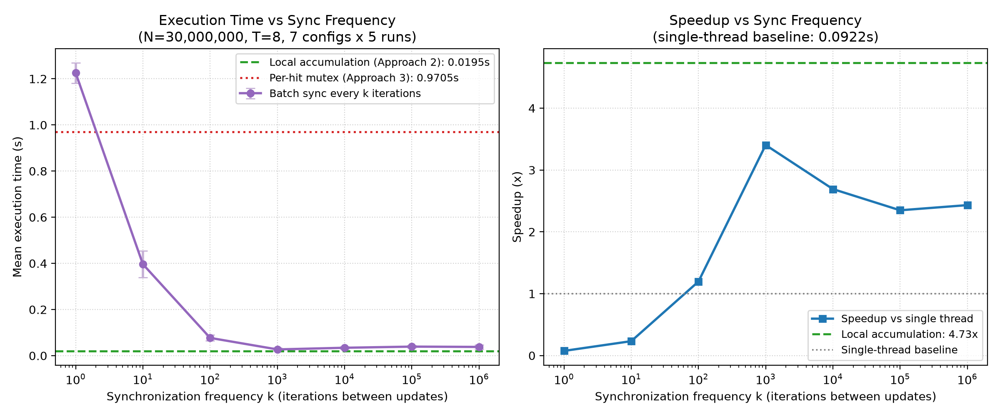

# Analysis and Explanations

**Exercise:** Week 3 — Multi-threading Best Practices via Monte Carlo π Estimation
**Scope:** Explains the measured behaviour required by Sections 5 and 6 of the specification.

---

## 1. Executive summary

1. The single-thread baseline estimates π as 3.141434 in **0.09594 s** for 30 million points.
2. Local accumulation (Approach 2) is the only design that scales cleanly: it reaches **2.08×** at 8 threads and ~**650 Mpoints/s**, then saturates; once the cores are saturated, additional threads do not help and eventually hurt.
3. Per-hit locking (Approach 3) is **3.3× slower than the single-thread baseline even with one thread**, and never exceeds **0.31×** speedup. Its cost is contention on a single cache line, not the arithmetic.
4. Reducing synchronization frequency from every hit to every 1,000 iterations improves execution time by **35.8×** (0.9705 s → 0.0271 s at T = 8) while preserving exact correctness.

---

## 2. Experimental setup

### 2.1 Primary benchmark environment

| Item | Value |
|:--|:--|
| OS / kernel | Ubuntu Linux 64-bit, running in VMware Workstation |
| Allocated hardware | 2 logical vCPUs, 4 GiB RAM |
| Host CPU (reference) | Intel Core i7-14650HX |
| Compiler / flags | GCC, `-O3 -pthread -Wall -Wextra -lm` |
| Problem size | N = 30,000,000 points (strong scaling) |
| Runs per configuration | 5; mean and standard deviation reported |
| Randomness | `xorshift64*`, one independent state per thread seeded from a master seed (`123456789`) |

The **supplementary** synchronization-frequency experiment (Section 6.1) was run
on a native Windows 11 host with 12 logical CPUs. Its absolute numbers are only
compared within that experiment, never against the 2-vCPU VM results.

### 2.2 Timing methodology

- Elapsed time uses `clock_gettime(CLOCK_MONOTONIC)`.
- Approach 1 times the computation loop only.
- Approaches 2 and 3 time `pthread_create` → worker execution (including
  contention) → `pthread_join`. Allocation, seed setup, mutex
  initialization/destruction, π calculation and printing are outside the
  timed region.
- No I/O occurs inside any measurement loop.
- Speedup is computed against the Approach 1 mean: `S = T_single / T_parallel`.
  Efficiency is `E = S / T`; throughput is `N / T_parallel`.

### 2.3 Designs under test

| Approach | Work distribution | Shared state in the hot loop | Synchronization |
|:--|:--|:--|:--|
| 1 — Single thread | All N points | None | None |
| 2 — Local accumulation | N/T per thread | None | One join + final reduction |
| 3 — Shared mutex | N/T per thread | Global counter | `pthread_mutex_lock` on **every point inside the circle** |
| 3b — Batch sync | N/T per thread | Global counter | Lock every *k* iterations, flush remainder at the end |

The expected fraction of points inside the circle is π/4 ≈ 0.785, so Approach 3
performs roughly **23.6 million lock/unlock pairs** for N = 30M.

---

## 3. Measured results

Full tables are in [`summary_tables.md`](../2_measurements/summary_tables.md);
raw runs are in [`measurements.csv`](../2_measurements/measurements.csv).

### 3.1 Correctness

All configurations estimate π between **3.141393** and **3.141816**, with
absolute error at most **0.00023**. The expected 1σ sampling error for
N = 30M is about 0.0003, so every result is within statistical expectation.

Within a given thread count, Approaches 2 and 3 produce **identical** π values
(e.g., both give 3.141393 at T = 8) because they use the same per-thread seeds.
This confirms that the mutex-protected shared counter loses no updates and that
the local reduction sums every partial count exactly. Increasing the thread
count does not improve accuracy at fixed N; it only reduces execution time.

### 3.2 Baseline (Approach 1)

| Mean time | Std. dev. | Throughput | Estimated π | Absolute error |
|--:|--:|--:|--:|--:|
| 0.09594 s | ± 0.00579 s | 312.7 Mpoints/s | 3.141434 | 0.000158 |

This 6% run-to-run spread sets the noise floor for every comparison that follows.

### 3.3 Approach 2 — local accumulation

| Threads | Mean time (s) | Speedup | Efficiency |
|:--:|--:|--:|--:|
| 1 | 0.0971 | 0.99× | 98.8% |
| 2 | 0.0572 | 1.68× | 83.9% |
| 4 | 0.0512 | 1.87× | 46.8% |
| 8 | **0.0461** | **2.08×** | 26.0% |
| 12 | 0.0602 | 1.59× | 13.3% |
| 32 | 0.0592 | 1.62× | 5.1% |
| 128 | 0.0679 | 1.41× | 1.1% |

### 3.4 Approach 3 — per-hit mutex

| Threads | Mean time (s) | Speedup | Efficiency |
|:--:|--:|--:|--:|
| 1 | 0.3133 | 0.31× | 30.6% |
| 2 | 0.6118 | 0.16× | 7.8% |
| 8 | 0.8150 | 0.12× | 1.5% |
| 32 | 0.7424 | 0.13× | 0.4% |
| 128 | 0.7342 | 0.13× | 0.1% |

### 3.5 Performance curves

---

## 4. Required explanations (Section 5.2)

### A. Why speedup is not proportional to the number of threads

Ideal strong scaling would give `S(T) = T` while `T` ≤ cores. Measured
Approach 2 instead gives 1.68× at 2 threads, 1.87× at 4 and 2.08× at 8. The
gap has four sources:

1. **A hard core limit.** The VM has 2 logical vCPUs. Once both are busy, extra
   runnable threads cannot execute simultaneously; they only add scheduling
   work. This is why the curve flattens near 2×.
2. **Parallel overhead included in the measurement.** Thread creation and join
   are inside the timed region. This is small at 2–8 threads but grows with
   every extra thread and becomes material at 100–128 threads.
3. **Shared micro-architectural resources.** Threads share the last-level
   cache, memory bandwidth and execution units (especially if the two logical
   CPUs are SMT siblings). Arithmetic throughput per thread therefore falls as
   more threads compete, and the per-core turbo frequency can drop when more
   cores are active.
4. **Fixed work per run and statistical noise.** At 30M points the baseline is
   only ~96 ms; 6% run-to-run variation at the baseline moves measured speedup
   by a comparable amount. Differences smaller than the error bars should not
   be treated as real.

**Diminishing returns** are visible directly: 1 → 2 threads gains 0.69× of
speedup; 2 → 4 gains 0.19×; 4 → 8 gains 0.21×; beyond 8 the speedup *decreases*.
Each additional thread buys less because the parallel fraction that can
actually run concurrently is already saturated.

### B. Saturation point

The speedup plateau begins at **2 threads**, the number of allocated logical
CPUs, and extends to about 8 threads (1.7–2.1×). The nominal maximum is
**2.08× at 8 threads**, but that is only 4% above the theoretical 2× ceiling and
is not sustained at higher counts; it should be read as a plateau, not as
evidence of 8-core scalability. The 12-thread run (1.59×) and 16-thread run
(1.68×) show that adding threads beyond the plateau does not recover the peak.

**Relation to hardware:** saturation at ~2× is exactly what a 2-vCPU allocation
predicts. Using the supplementary 12-CPU host for comparison, the same
local-accumulation code reaches 4.73× at 8 threads, confirming that the plateau
in the VM is imposed by its core allocation rather than by the algorithm.

### C. Oversubscription

Threads above the 2-vCPU allocation oversubscribe the machine. Measured
behaviour:

- 12–64 threads: 0.058–0.060 s, speedup 1.59–1.68×, i.e., **~30% slower than
  the 8-thread best**.
- 100–128 threads: 0.066–0.068 s, speedup 1.41–1.45×, i.e., **~43–47% slower**.

At 128 threads each worker handles only ~234,000 points (about 0.75 ms of work
at the single-thread throughput). Thread creation, join, scheduler bookkeeping
and cache pollution are then a significant fraction of each thread's lifetime. The OS time-slices the runnable
threads across 2 CPUs; every context switch saves and restores registers and
pollutes cache/TLB state, so useful arithmetic competes with scheduling
overhead. The result is the expected **increasing → plateau → decreasing**
pattern.

The small rise from 2 threads (1.68×) to 8 threads (2.08×) is counter-intuitive
for a strict 2-vCPU allocation. Plausible causes are host-level scheduling and
CPU-frequency variation between runs, plus the 19% standard deviation observed
at 2 threads. It does not continue beyond 8 threads, so it does not change the
conclusion that the practical saturation point is the core count.

### D. Synchronization cost: why Approach 3 is worse than Approach 2

Approach 3 locks a global mutex on every point that falls inside the circle —
about **23.6 million** lock/unlock pairs. Approach 2 never touches shared memory
in the hot loop; it writes one local counter and performs a single reduction
after all joins.

Measured consequences:

- **Single thread:** 0.3133 s vs 0.09594 s baseline → **3.27× slower**, even
  with zero contention. The extra ~0.217 s is the lock/unlock cost itself
  (roughly 9 ns per acquisition over 23.6M hits).
- **8 threads:** 0.8150 s vs 0.0461 s for Approach 2 → **17.7× slower**.
  Aggregate time is roughly constant (0.70–0.83 s) for 4–128 threads, which
  shows that the serialized critical-section work dominates; adding threads
  adds queueing, not throughput.
- **Throughput:** 36–49 Mpoints/s for Approach 3 versus 525–651 Mpoints/s for
  Approach 2.

**Mechanism.** `pthread_mutex_lock` is an atomic read-modify-write on a shared
cache line. When several cores contend for it, the cache line migrates between
their private caches ("cache-line ping-pong"), and only one thread can execute
the increment at a time. The useful work inside the critical section is a single
integer increment — a few nanoseconds — while an uncontended acquisition costs
on the order of 9 ns and a contended acquisition costs tens of nanoseconds.
The critical section is therefore almost pure overhead, and it **serializes**
78.5% of the iterations.

**Approach 3 vs Approach 2 in OS terms:** the shared counter creates a critical
section that must be executed sequentially; local accumulation removes the
critical section entirely and defers combination to an O(T) reduce phase. The
map-reduce design eliminates contention rather than trying to make contention
cheap.

### E. Why parallel efficiency decreases with thread count

Efficiency is `E = S/T`. Even below saturation, part of each thread's time goes
to creation/join, cache sharing and frequency effects, so `S < T` and
`E < 100%`:

- Approach 2: 98.8% at 1 thread, 83.9% at 2, 46.8% at 4, 26.0% at 8, 13.3% at
  12, 1.1% at 128.
- Approach 3: 30.6% at 1 thread (lock overhead already consumes 69% of the
  baseline), 7.8% at 2, 1.5% at 8, 0.1% at 128.

Above the core count, speedup saturates while the denominator keeps growing,
so efficiency falls roughly as `1/T` by construction. The metric is most
informative for `T ≤ cores`; beyond that it mainly quantifies how much
oversubscription is being paid for. The practical lesson is to report both
speedup and efficiency, and to avoid quoting efficiency at thread counts far
above the available cores as if it measured code quality.

---

## 5. Trade-off experiments (specification Section 6)

### 5.1 Synchronization frequency (specification 6.1)

Approach 3 was modified to update the shared counter every *k* iterations
instead of on every hit (`src/approach3_batch.c`). Measured on the 12-CPU host
at N = 30M, T = 8, 5 runs per point:

| k | Mean time (s) | Speedup vs single |
|--:|--:|--:|
| 1 | 1.2252 | 0.08× |
| 10 | 0.3964 | 0.23× |
| 100 | 0.0770 | 1.20× |
| **1,000** | **0.0271** | **3.40×** |
| 10,000 | 0.0342 | 2.69× |
| 100,000 | 0.0392 | 2.35× |
| 1,000,000 | 0.0379 | 2.43× |

- Moving from per-hit locking to `k = 1,000` cuts time by **35.8×** and raises
  speedup from 0.095× to 3.40×.
- The sweet spot is around **k = 1,000**: about 30,000 updates in total instead
  of 23.6 million. Beyond this point the curve is flat within noise
  (0.027–0.039 s).
- The local-accumulation floor is **0.0195 s**. Even at very large *k* the batch
  version stays 1.4–2× above it, because it still pays a per-iteration
  `(i + 1) % k` test (an integer division/modulo with a runtime divisor) and the
  final flush. This is a separate, useful lesson: **how** you batch matters.
  A countdown (`if (++since_update == k)`) or block-wise processing avoids the
  per-iteration modulo.
- Correctness is unchanged: every configuration estimates π as **3.141393**.
  Batching changes when the counter is updated, not how many points are counted.

### 5.2 Thread scaling below / at / above the core count (specification 6.2)

With 2 logical vCPUs:

| Region | Threads tested | Observed |
|:--|:--|:--|
| Below cores | 1 | 0.99× (no parallelism) |
| At cores | 2 | 1.68×, 83.9% efficiency |
| Above cores | 4, 6, 8 | 1.87–2.08× (plateau) |
| Far above cores | 12–128 | 1.41–1.68× (decreasing) |

The full curve therefore shows the required **increasing → plateau →
decreasing** pattern. In the supplementary 12-CPU experiment, 8 threads is
*below* the core count and yields 4.73×, which confirms that "below/at/above"
must be defined relative to the actual allocated CPUs, not a fixed number.

### 5.3 Local vs shared computation (specification 6.3)

Same N, same T, same seeds — only the accumulation strategy differs:

| Threads | Approach 2 (local) | Approach 3 (shared mutex) | Ratio |
|:--:|--:|--:|--:|
| 1 | 0.0971 s | 0.3133 s | 3.2× |
| 2 | 0.0572 s | 0.6118 s | 10.7× |
| 8 | 0.0461 s | 0.8150 s | **17.7×** |
| 32 | 0.0592 s | 0.7424 s | 12.5× |
| 128 | 0.0679 s | 0.7342 s | 10.8× |

- **Critical section:** Approach 3 executes ~23.6M critical sections;
  Approach 2 executes none in the loop.
- **Contention:** every thread in Approach 3 competes for one mutex and one
  cache line; contention grows with thread count.
- **Serialization:** the shared increment cannot overlap, so aggregate time in
  Approach 3 is nearly independent of T (0.70–0.83 s for T ≥ 4) while
  Approach 2's time falls with T until saturation.

This is the central best-practice result: **prefer local accumulation plus a
final reduction over frequent shared updates.**

---

## 6. Threats to validity and limitations

- The primary benchmark runs in a 2-vCPU VM on a shared host; scheduling noise
  and frequency scaling affect absolute times. The 6% baseline spread and the
  19% spread at Approach 2 / T = 2 limit how finely configurations can be
  ranked.
- The 8-thread peak (2.08×) is slightly above the 2× core ceiling and should not
  be generalized; it is best interpreted as a plateau value.
- The synchronization-frequency experiment ran on a different machine (12
  logical CPUs, Windows 11), so its absolute times cannot be compared with the
  VM tables. Comparisons are valid only within that experiment.
- Only wall-clock time was measured. Context-switch counts, cache misses and
  per-thread CPU time were not collected, so the mechanistic explanations above
  are inferences from timing behaviour rather than direct hardware counters.
- Thread creation/join is inside the parallel timing but has no counterpart in
  Approach 1. This is a deliberate, conservative choice; it slightly penalizes
  high thread counts rather than hiding their overhead.
- The batch variant uses `(i + 1) % k`, which adds a per-iteration modulo cost;
  the measured batch curve therefore includes overhead beyond the lock itself.
- The master seed is fixed (`123456789`) and repetition *r* uses the deterministic
  derived seed `master + 99991r`, so the whole experiment is reproducible while
  the π estimates from different repetitions differ only by sampling noise.

---

## 7. Conclusion

The measurements support a clear ordering of designs:

1. **Approach 2 (map-reduce with thread-local counters)** is correct and
   scalable up to the available cores. It reaches ~2× on 2 vCPUs and 4.7× on a
   12-CPU host, with exact aggregation and no contention.
2. **Approach 3 (per-hit mutex)** is correct but pathologically slow: 0.12–0.31×
   speedup, up to 17.7× slower than Approach 2, because the critical section
   serializes most of the work.
3. **Batched synchronization** recovers most of the lost performance (35.8×
   faster than per-hit locking at k = 1,000) and preserves correctness, but it
   still trails purely local accumulation and must be implemented without a
   costly per-iteration modulo.

The overarching OS lesson: parallel speedup is limited by cores, by the serial
fraction and synchronization in the design, and by scheduler overhead under
oversubscription — not by the number of threads you create.
